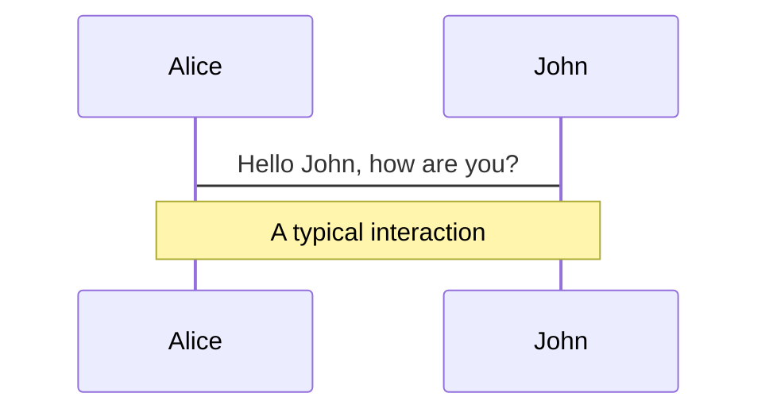
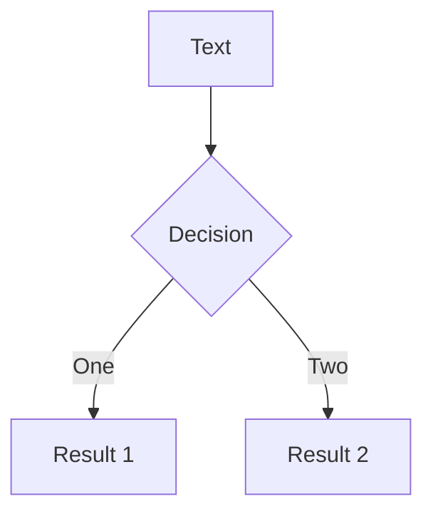
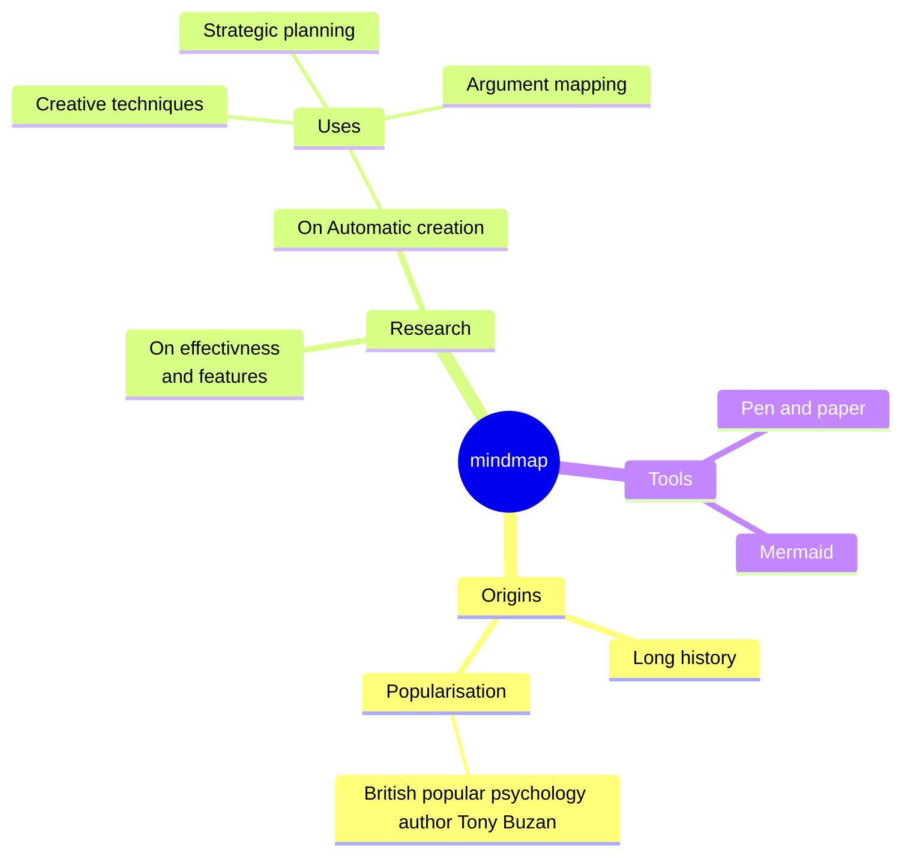
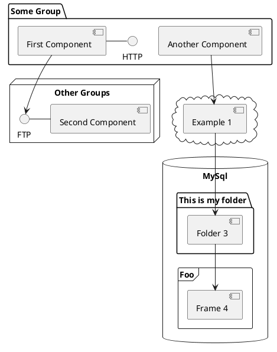

# Arbitrary-sized unsigned integers

By John Sorial

---
layout: default
---
# Motivation

<div class="grid grid-cols-2 gap-5">
<div class="flex flex-justify-center flex-col flex-items-center flex-content-center h-100">


</div>
<div>

<div class="flex flex-justify-center flex-col flex-content-center h-100">
<div class="-translate-y-10">
Implementieren Sie nun folgende Funktionen:
</div>

1. `printBigUInt()`: gibt die ganze Zahl zur Basis 10 auf der Kommandozeile aus.
2. `addBigUInt()`: summiert zwei BigUInts
3. `multiplyBigUInt()`: Multipliziert zwei BigUInts

</div>
</div>

</div>

---

# Goals

* Implement the basic math operations + - * $\div$

* Implement some bitwise operations >>

* Logical operators = < >

* Learn some C++ quirks

---

<div style="display: flex; align-items: center; justify-content: center;flex-direction: column">
    <h1>The holy rule</h1>
    <h4>The operations of the base type must be used</h4>
</div>

## Forbidden

1. Multiplication is repeated addition.
2. Division is repeated subtraction.
3. Manipulate bits one by one.

---
src: ./slides/class-structure.md
---

---
layout: section
---

# Addition +

---
layout: default
---

# Addition +

The naive version


<div class="relative grid grid-cols-5 content-start place-items-stretch right-3">


<div class="col-span-3 h-40vh flex flex-content-center flex-items-center">

```cpp {all|2|4-6|8|all}{lines:true}
uint_192 operator+(const uint_192 &lhs, const uint_192 &rhs) {
    uint_192 result{};
    
    for (uint64_t i = 0; i < lhs.parts.size(); ++i) {
        result.parts[i] += lhs.parts[i] + rhs.parts[i];
    }
    
    return result;
}
```

</div>

<div class="grid grid-rows-3">

<div>
<v-clicks>

```cpp {1|1-2|all} 
uint_192 a{0,0,0} // 0;
uint_192 b{0,0,0}; // 0;
auto c = a + b; 
// {0,0,0}
// 0
```

```cpp
uint_192 a{1,2,0} // 55340232221128654848;
uint_192 b{1,0,0}; // 1
auto c = a + b; 
// {2,2,0}
// 55340232221128654849
```

<div>

```cpp
uint_192 a{UINT64_MAX,0,0} // 18446744073709551615;
uint_192 b{1,0,0}; // 1
auto c = a + b; 
// {0,0,0}
// 0
```

</div>


</v-clicks>

</div>


</div>

</div>


---

<v-clicks>
```cpp
uint_192 a{1,2,0} // 55340232221128654848;
uint_192 b{1,0,0}; // 1
auto c = a + b; 
// {2,2,0}
// 55340232221128654849
```

<div ref="data">

```cpp
uint_192 a{UINT64_MAX,0,0} // 18446744073709551615;
uint_192 b{1,0,0}; // 1
auto c = a + b; 
// {0,0,0}
// 0
```

</div>

</v-clicks>

{{a}}
{{b}}

<script setup lang="ts">

import { watch ,ref,Ref } from 'vue';


const a: Ref<number> = $clicks;
const b = "Ads";
const data:Ref<HTMLElement> = ref(null);

watch(a, (newNumber,oldnumber) => {
  if (newNumber==2){
    alert(data.value.innerText)
data.value.innerText= "as"

  }
})
</script>


---

# Addition +

The Problem

Assume we have 8 bits unsigned numbers (range 0-255)

<div class="flex gap-x-12">

$a=230$

$b=180$

</div>

<div class="flex gap-x-1">

$a + b=$

<div v-click>

<div v-if="$clicks==1" class="text-red-400">

$360$

</div>

</div>

<div v-click>

<div v-if="$clicks==2" v-motion-slide-left>

$255+155$

</div>

<div v-if="$clicks==2" v-motion-fade class="relative left-40 bottom-10.5">

$(11111111)_{2} + (10011011)_{2}$

</div>

<div v-if="$clicks==2" v-motion-fade class="relative left-120 bottom-20.5">

$(11111111)_{2} + (10011011)_{2}$

</div>

</div>
</div>


---
layout: default
---

# Addition +

<div class="flex flex-justify-center flex-items-center flex-col flex h-90">

## How do we determine the carry?

</div>


---

# Addition + : How do we determine the carry?

---

<div class="grid grid-cols-4">

<div class="col-span-3">

```cpp {all|2-3|5|3,6|7|8|all}{lines:true}
constexpr uint_192 operator+(const uint_192 &lhs, const uint_192 &rhs) noexcept {
    uint_192 result{};
    uint64_t carry{0};

    for (uint64_t i = 0; i < lhs.parts.size(); ++i) {
        result.parts[i] += carry_bit;
        result.parts[i] += lhs.parts[i] + rhs.parts[i];
        carry_bit = result.parts[i] < lhs.parts[i];
    }
    return result;
}
```

</div>

<div class="flex flex-col flex-content-center flex-justify-center">

2. Is carry just a boolean?

</div>

</div>


---
layout: two-cols-header
---


# Proof: Maximal 1 bit needs to be carried over

<!-- Removes spacing caused by .katex-display -->

<style>
.katex-display{
    display: flex;
    padding-left: 50px;
}
</style>

::left::

$$ {1|3|all}

\begin{align*}

R=& (111....)_2 + (111....)_2 \\
=& \sum_{x=0}^{n-1} 2^x + \sum_{x=0}^{n-1} 2^x \\

=& \: 2*{\sum_{x=0}^{n-1} 2^x} \\

=& \: 2*(2^{n} - 1)\\

=& \: 2^{n+1} - 2 \\

=& \: \sum_{x=0}^{n} 2^x - 1 \\

=& \: \sum_{x=1}^{n} 2^x \\

%<& \: 2^{n+1}

=& \: (11...10)_2

\end{align*}
$$


<div v-click>
    <div class="absolute left-355px top-170px" v-if="$clicks==1" v-motion-slide-left>
        n=4
    </div>
    <Arrow x1="300" y1="200" x2="450" y2="200" v-if="$clicks ==1" v-motion-slide-left/>

</div>

::right::

$$
\begin{align*}

R=& (1111)_2 + (1111)_2 \\
=& \sum_{x=0}^{3} 2^x + \sum_{x=0}^{3} 2^x \\

=& \: 2*{\sum_{x=0}^{3} 2^x} \\

=& \: 2*(2^{4} - 1)\\

=& \: 2^{5} - 2 \\

=& \: \sum_{x=0}^{4} 2^x - 1 \\

=& \: \sum_{x=1}^{4} 2^x = 2^{1} + 2^{2} + 2^{3} + 2^{4} \\

=& \: (11110)_2
\end{align*}
$$

---

# Themes

Slidev comes with powerful theming support. Themes can provide <styles, layouts, components, or even configurations for
tools. Switching between themes by just **one edit** in your frontmatter:
>
<div grid="~ cols-2 gap-2" m="t-2">

```yaml
---
theme: default
---
```

```yaml
---
theme: seriph
---
```


</div>

Read more about [How to use a theme](https://sli.dev/themes/use.html) and
check out the [Awesome Themes Gallery](https://sli.dev/themes/gallery.html).

---
preload: false
---

# Animations

Animations are powered by [@vueuse/motion](https://motion.vueuse.org/).

```html

<div
        v-motion
        :initial="{ x: -80 }"
        :enter="{ x: 0 }">
    Slidev
</div>
```

<!-- vue script setup scripts can be directly used in markdown, and will only affects current page -->
<script setup lang="ts">
const final = {
  x: 0,
  y: 0,
  rotate: 0,
  scale: 1,
  transition: {
    type: 'spring',
    damping: 10,
    stiffness: 20,
    mass: 2
  }
};

const a = "5+5";
</script>

<div
  v-motion
  :initial="{ x:35, y: 40, opacity: 0}"
  :enter="{ y: 0, opacity: 1, transition: { delay: 3500 } }">

[Learn More](https://sli.dev/guide/animations.html#motion)

</div>

---

# LaTeX

LaTeX is supported out-of-box powered by [KaTeX](https://katex.org/).

<br>

Inline $\sqrt{3x-1}+(1+x)^2$

Block
$$ {1|3|all}
\begin{array}{c}

\nabla \times \vec{\mathbf{B}} -\, \frac1c\, \frac{\partial\vec{\mathbf{E}}}{\partial t} &
= \frac{4\pi}{c}\vec{\mathbf{j}} \nabla \cdot \vec{\mathbf{E}} & = 4 \pi \rho \\

\nabla \times \vec{\mathbf{E}}\, +\, \frac1c\, \frac{\partial\vec{\mathbf{B}}}{\partial t} & = \vec{\mathbf{0}} \\

\nabla \cdot \vec{\mathbf{B}} & = 0

\end{array}
$$

<br>

[Learn more](https://sli.dev/guide/syntax#latex)

---

# Diagrams

You can create diagrams / graphs from textual descriptions, directly in your Markdown.

<div class="grid grid-cols-4 gap-5 pt-4 -mb-6">









</div>

[Learn More](https://sli.dev/guide/syntax.html#diagrams)

---
src: ./pages/multiple-entries.md
hide: false
---

---
layout: center
class: text-center
---

# Learn More

[Documentations](https://sli.dev) · [GitHub](https://github.com/slidevjs/slidev) · [Showcases](https://sli.dev/showcases.html)
