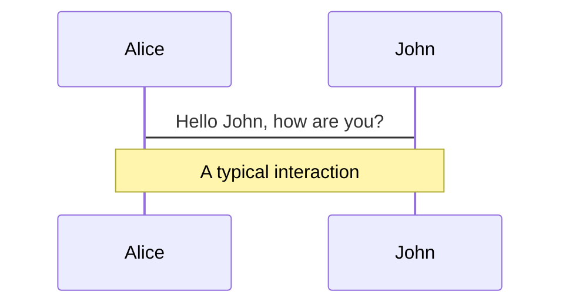
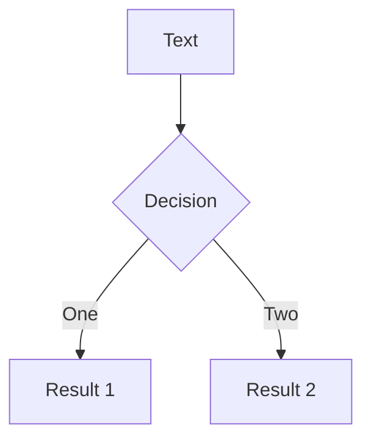
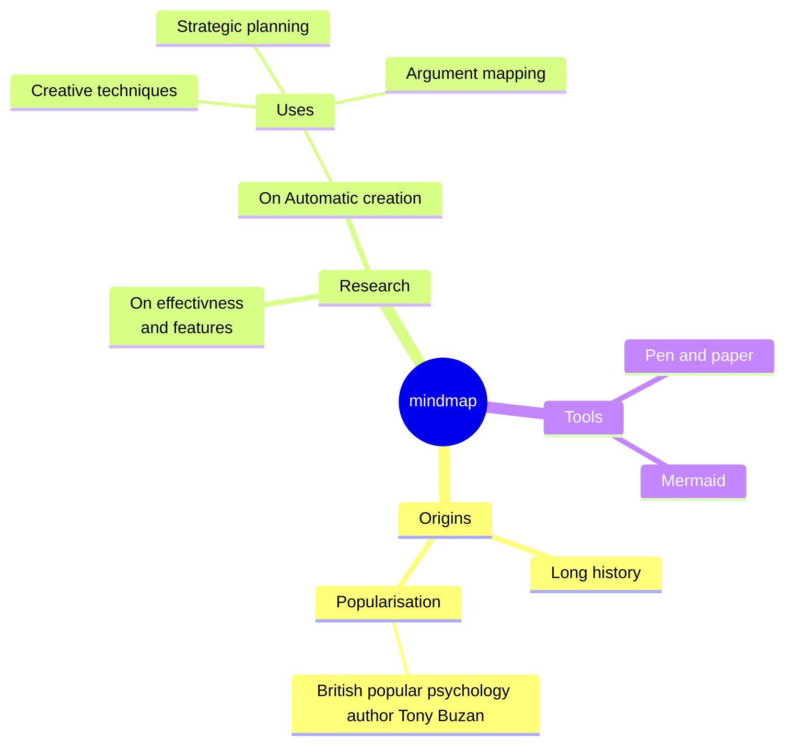
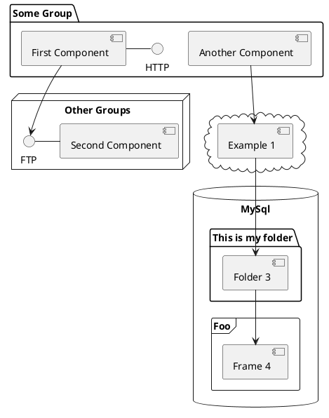

# Arbitrary-sized unsigned integers

By John Sorial

---
layout: default
---

# Motivation

* Curiosity
*

---

# Goals

* Implement the basic math operations + - * $\div$

* Implement some bitwise operations >>

* Logical operators = < >

* Learn some C++ quircks

---

<div style="display: flex; align-items: center; justify-content: center;flex-direction: column">
    <h1>The holy rule</h1>
    <h4>The operations of the base type must be used</h4>
</div>

## Forbidden

1. Multiplication is repeated addition.
2. Division is repeated subtraction.
3. Manipulate bits one by one.

---
---

# Class Structure

<div id="cpp_uint_192_struct" class="flex flex-justify-center flex-col flex-content-center flex-items-center">

```c++
struct uint_192 {
    std::array<std::uint64_t, 3> parts;
}
```

<div v-click class="grid grid-cols-4 grid-rows-3 gap-x-9xl pa-2 mt-2">
    <div class="flex flex-justify-center">
        Binary
    </div>
    <div class="flex flex-justify-center">
        00000
    </div>
    <div class="flex flex-justify-center">
        00000
    </div>
    <div class="flex flex-justify-center">
        00000
    </div>
    <div class="flex flex-justify-center">
        Base 10
    </div>
    <div class="flex flex-justify-center">
        0
    </div>
    <div class="flex flex-justify-center">
        0
    </div>
    <div class="flex flex-justify-center">
        0
    </div>
    <div class="flex flex-justify-center">
        Index
    </div>
    <div class="flex flex-justify-center">
        2
    </div>
    <div class="flex flex-justify-center">
        1
    </div>
    <div class="flex flex-justify-center">
        0
    </div>
</div>
</div>

<div class="grid grid-cols-2 grid-rows-1 gap-x-9xl pa-2 mt-2">

<div v-click class="flex flex-justify-center flex-col flex-content-center flex-items-center" >

```c++
uint_192 ones{1,1,1};
```

<div class="grid grid-cols-4 grid-rows-4 gap-x-9xl pa-2">
    <div class="flex flex-justify-center">
        Binary
    </div>
    <div class="flex flex-justify-center">
        00001
    </div>
    <div class="flex flex-justify-center">
        00001
    </div>
    <div class="flex flex-justify-center">
        00001
    </div>
    <div class="flex flex-justify-center">
        Base10
    </div>
    <div class="flex flex-justify-center">
        1
    </div>
    <div class="flex flex-justify-center">
        1
    </div>
    <div class="flex flex-justify-center">
        1
    </div>
    <div class="flex flex-justify-center">
        Index
    </div>
    <div class="flex flex-justify-center">
        2
    </div>
    <div class="flex flex-justify-center">
        1
    </div>
    <div class="flex flex-justify-center">
        0
    </div>
    <div class="flex flex-justify-center">
        Value
    </div>
    <div class="flex flex-justify-center max-h-2em col-span-3">

<div class="-translate-y-4 translate-x-1">

$2^{128}+2^{64}+2^{0}$

</div>

</div>
</div>
</div>

<div v-click class="flex flex-justify-center flex-col flex-content-center flex-items-center" >

```c++
uint_192 ones{1,1,1};
```

<div class="grid grid-cols-4 grid-rows-4 gap-x-9xl pa-2">
    <div class="flex flex-justify-center">
        Binary
    </div>
    <div class="flex flex-justify-center">
        00001
    </div>
    <div class="flex flex-justify-center">
        00001
    </div>
    <div class="flex flex-justify-center">
        00001
    </div>
    <div class="flex flex-justify-center">
        Base10
    </div>
    <div class="flex flex-justify-center">
        1
    </div>
    <div class="flex flex-justify-center">
        1
    </div>
    <div class="flex flex-justify-center">
        1
    </div>
    <div class="flex flex-justify-center">
        Index
    </div>
    <div class="flex flex-justify-center">
        2
    </div>
    <div class="flex flex-justify-center">
        1
    </div>
    <div class="flex flex-justify-center">
        0
    </div>
    <div class="flex flex-justify-center">
        Value
    </div>
    <div class="flex flex-justify-center max-h-2em col-span-3">

<div class="-translate-y-4 translate-x-1">

$2^{128}+2^{64}+2^{0}$

</div>

</div>
</div>
</div>


</div>

<style>

code[class*='language-c++'] {
    font-size: 1.5em;
}

</style>

---
layout: two-cols-header
---

<!-- Removes spacing caused by .katex-display -->

# Proof: Maximal 1 bit needs to be carried over

<style>
.katex-display{
    display: flex;
    padding-left: 50px;
}
</style>

::left::

$$

\begin{align*}

R=& (111....)_2 + (111....)_2 \\
=& \sum_{x=0}^{n-1} 2^x + \sum_{x=0}^{n-1} 2^x \\

=& \: 2*{\sum_{x=0}^{n-1} 2^x} \\

=& \: 2*(2^{n} - 1)\\

=& \: 2^{n+1} - 2 \\

=& \: \sum_{x=0}^{n} 2^x - 1 \\

=& \: \sum_{n=1}^{n} 2^x \\

%<& \: 2^{n+1}

=& \: (11...10)_2

\end{align*}
$$


<div v-click>
    <div class="absolute left-355px top-170px" v-if="$clicks==1" v-motion-slide-left>
        n=4
    </div>
    <Arrow x1="300" y1="200" x2="450" y2="200" v-if="$clicks ==1" v-motion-slide-left/>

</div>

::right::

$$
\begin{align*}

R=& (1111)_2 + (1111)_2 \\
=& \sum_{x=0}^{3} 2^x + \sum_{x=0}^{3} 2^x \\

=& \: 2*{\sum_{x=0}^{3} 2^x} \\

=& \: 2*(2^{4} - 1)\\

=& \: 2^{5} - 2 \\

=& \: \sum_{x=0}^{4} 2^x - 1 \\

=& \: \sum_{x=1}^{4} 2^x = 2^{1} + 2^{2} + 2^{3} + 2^{4} \\

=& \: (11110)_2
\end{align*}
$$

# Components

<div grid="~ cols-2 gap-4">
<div>

You can use Vue components directly inside your slides.

We have provided a few built-in components like `<Tweet/>` and `<Youtube/>` that you can use directly. And adding your
custom components is also super easy.

```html

<Counter :count="10"/>
```

<!-- ./components/Counter.vue -->
<Counter :count="10" m="t-4" />

Check out [the guides](https://sli.dev/builtin/components.html) for more.

</div>
<div>

```html

<Tweet id="1390115482657726468"/>
```

<Tweet id="1390115482657726468" scale="0.65" />

</div>
</div>

<!--
Presenter note with **bold**, *italic*, and ~~striked~~ text.

Also, HTML elements are valid:
<div class="flex w-full">
  <span style="flex-grow: 1;">Left content</span>
  <span>Right content</span>
</div>
-->

---
class: px-20
---

# Themes

Slidev comes with powerful theming support. Themes can provide styles, layouts, components, or even configurations for
tools. Switching between themes by just **one edit** in your frontmatter:

<div grid="~ cols-2 gap-2" m="t-2">

```yaml
---
theme: default
---
```

```yaml
---
theme: seriph
---
```


</div>

Read more about [How to use a theme](https://sli.dev/themes/use.html) and
check out the [Awesome Themes Gallery](https://sli.dev/themes/gallery.html).

---
preload: false
---

# Animations

Animations are powered by [@vueuse/motion](https://motion.vueuse.org/).

```html

<div
        v-motion
        :initial="{ x: -80 }"
        :enter="{ x: 0 }">
    Slidev
</div>
```

<div class="w-60 relative mt-6">
  <div class="relative w-40 h-40">
    
    
    
  </div>

  <div
    class="text-5xl absolute top-14 left-40 text-[#2B90B6] -z-1"
    v-motion
    :initial="{ x: -80, opacity: 0}"
    :enter="{ x: 0, opacity: 1, transition: { delay: 2000, duration: 1000 } }">
    Slidev
  </div>
</div>

<!-- vue script setup scripts can be directly used in markdown, and will only affects current page -->
<script setup lang="ts">
const final = {
  x: 0,
  y: 0,
  rotate: 0,
  scale: 1,
  transition: {
    type: 'spring',
    damping: 10,
    stiffness: 20,
    mass: 2
  }
}
</script>

<div
  v-motion
  :initial="{ x:35, y: 40, opacity: 0}"
  :enter="{ y: 0, opacity: 1, transition: { delay: 3500 } }">

[Learn More](https://sli.dev/guide/animations.html#motion)

</div>

---

# LaTeX

LaTeX is supported out-of-box powered by [KaTeX](https://katex.org/).

<br>

Inline $\sqrt{3x-1}+(1+x)^2$

Block
$$ {1|3|all}
\begin{array}{c}

\nabla \times \vec{\mathbf{B}} -\, \frac1c\, \frac{\partial\vec{\mathbf{E}}}{\partial t} &
= \frac{4\pi}{c}\vec{\mathbf{j}} \nabla \cdot \vec{\mathbf{E}} & = 4 \pi \rho \\

\nabla \times \vec{\mathbf{E}}\, +\, \frac1c\, \frac{\partial\vec{\mathbf{B}}}{\partial t} & = \vec{\mathbf{0}} \\

\nabla \cdot \vec{\mathbf{B}} & = 0

\end{array}
$$

<br>

[Learn more](https://sli.dev/guide/syntax#latex)

---

# Diagrams

You can create diagrams / graphs from textual descriptions, directly in your Markdown.

<div class="grid grid-cols-4 gap-5 pt-4 -mb-6">









</div>

[Learn More](https://sli.dev/guide/syntax.html#diagrams)

---
src: ./pages/multiple-entries.md
hide: false
---

---
layout: center
class: text-center
---

# Learn More

[Documentations](https://sli.dev) · [GitHub](https://github.com/slidevjs/slidev) · [Showcases](https://sli.dev/showcases.html)
